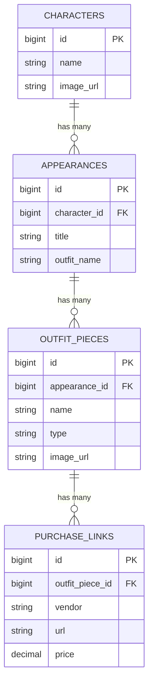

# Backend Brief: Character → Appearance → Costume Pieces

## What to tell the backend engineer

FanCon already has a **characters** table. For Cosplay Builder, we need:

1. A way to attach **appearances** (outfits) to a character
2. A way to attach **costume pieces** to an appearance
3. Later: save a user's specific build of that appearance

For now, ignore user builds. Focus on the catalog relationships.

---

## The mental model (simple)

```
Yelena Belova (Character)
 ├── Black Widow (2021) - Tactical Gear (Appearance)
 │    ├── White Jumpsuit (Costume Piece)
 │    ├── Tactical Vest
 │    ├── Utility Belt
 │    ├── White Lace-up Boots
 │    ├── Fingerless Gloves
 │    ├── Holster
 │    └── Wig
 │
 └── Thunderbolts* (2025) - Tactical Gear (Appearance)
      ├── Black Bodysuit
      ├── Utility Belt
      ├── Black Boots
      ├── Fingerless Gloves
      ├── Holster
      └── Wig
```

---

## Relationships (you were right)

| Relationship | Type | Meaning |
|---|---|---|
| Character → Appearances | **One-to-Many** | One character has many appearances |
| Appearance → Costume Pieces | **One-to-Many** | One appearance has many costume pieces |
| Costume Piece → Purchase Links | **One-to-Many** | One piece can have many buy links |

So yes:

> One character has many appearances.  
> One appearance has many costume pieces.

That is the core of it.

---

## Do we need join tables?

### For character → appearance → pieces: **No**

You do **not** need join tables for these.

Use foreign keys only:

```
characters (already exists in FanCon)
    ↑
    │ character_id
    │
appearances
    ↑
    │ appearance_id
    │
outfit_pieces
    ↑
    │ outfit_piece_id
    │
purchase_links
```

### Why no join table?

A join table is for **many-to-many** relationships.

Examples that WOULD need a join table:
- A student can take many classes, and a class has many students
- A tag can apply to many characters, and a character can have many tags

Our case is different:

- An appearance belongs to **one** character
- A costume piece belongs to **one** appearance (for now)

So foreign keys are enough.

---

## Recommended tables (MVP)

### 1. Use FanCon's existing `characters` table

Do **not** recreate characters if FanCon already has them.

Just store `character_id` on appearances, pointing at FanCon's character id.

Example:

| characters.id | name |
|---|---|
| 3 | Yelena Belova |

### 2. `appearances`

| Column | Purpose |
|---|---|
| id | Primary key |
| character_id | FK → characters.id |
| title | e.g. "Black Widow (2021)" |
| outfit_name | e.g. "Tactical Gear" |
| description | Short blurb |
| image_url | Optional appearance image |
| release_year | Optional |

### 3. `outfit_pieces`

| Column | Purpose |
|---|---|
| id | Primary key |
| appearance_id | FK → appearances.id |
| name | e.g. "White Jumpsuit" |
| type | Clothing / Accessory / Footwear / Wig |
| image_url | Preview image |
| estimated_cost_min | Low price |
| estimated_cost_max | High price |
| difficulty_level | Easy / Medium / Hard |
| is_optional | true/false |
| notes | Optional notes |
| display_order | Sort order in UI |

### 4. `purchase_links` (optional but recommended)

| Column | Purpose |
|---|---|
| id | Primary key |
| outfit_piece_id | FK → outfit_pieces.id |
| vendor | Amazon / Etsy / etc |
| url | Buy link |
| price | Vendor price |
| in_stock | true/false |

---

## Important design choice: shared pieces

Look at Yelena:

- Both appearances have **Utility Belt**, **Fingerless Gloves**, **Holster**, **Wig**

You have two options:

### Option A — Keep it simple (recommended for MVP)

Duplicate the piece rows per appearance.

```
Appearance 1 (Black Widow)
  └── Wig (id=7, appearance_id=1)

Appearance 2 (Thunderbolts)
  └── Wig (id=13, appearance_id=2)
```

**Pros**
- Super simple
- No join table
- Easy for frontend
- Matches current mock data

**Cons**
- Some duplicated names/data

### Option B — Reuse pieces with a join table (real-world / recommended long-term)

If the same costume piece can appear on **many appearances** (and therefore many characters), that is **many-to-many**.

Important nuance:
- Pieces don't "belong to characters" directly
- Pieces belong to **appearances**
- Characters own appearances
- So the join is: **appearances ↔ outfit_pieces**

```
characters
  └── appearances
         ╲
          ╲ many-to-many
           ╲
            appearance_outfit_pieces   ← JOIN TABLE
           ╱
          ╱
outfit_pieces (shared catalog)
```

#### Join table columns

```sql
CREATE TABLE appearance_outfit_pieces (
    id BIGSERIAL PRIMARY KEY,
    appearance_id BIGINT NOT NULL REFERENCES appearances(id) ON DELETE CASCADE,
    outfit_piece_id BIGINT NOT NULL REFERENCES outfit_pieces(id) ON DELETE CASCADE,

    -- Optional: per-appearance overrides
    display_order INTEGER DEFAULT 0,
    is_optional BOOLEAN DEFAULT false,
    notes TEXT,

    CONSTRAINT appearance_piece_unique UNIQUE (appearance_id, outfit_piece_id)
);
```

Then `outfit_pieces` no longer has `appearance_id`.  
It becomes a reusable catalog of pieces.

#### Why this matches real life

Example:
- "Fingerless Gloves" can be used by Yelena (Black Widow) AND Yelena (Thunderbolts) AND maybe another character later
- You store the gloves **once**
- You link that one piece to many appearances through the join table

#### Pros
- No duplicate piece definitions
- One update updates all appearances using that piece
- Matches real-world product reuse

#### Cons
- Slightly more complex queries
- If one appearance needs different notes/order, put those on the join table

### Recommendation

If reuse across characters/appearances is expected, tell the backend engineer to build **Option B** from the start.

Frontend still gets the same nested response shape — the join table is an implementation detail.

---

## How Python (SQLAlchemy) models many-to-many

In Python backends (FastAPI / Flask + SQLAlchemy), many-to-many is done with a join table + `relationship(..., secondary=...)`.

### Simple many-to-many

```python
from sqlalchemy import Column, BigInteger, String, ForeignKey, Table
from sqlalchemy.orm import relationship, DeclarativeBase

class Base(DeclarativeBase):
    pass

# JOIN TABLE
appearance_outfit_pieces = Table(
    "appearance_outfit_pieces",
    Base.metadata,
    Column("appearance_id", ForeignKey("appearances.id"), primary_key=True),
    Column("outfit_piece_id", ForeignKey("outfit_pieces.id"), primary_key=True),
)

class Appearance(Base):
    __tablename__ = "appearances"

    id = Column(BigInteger, primary_key=True)
    title = Column(String)

    # many appearances <-> many pieces
    outfit_pieces = relationship(
        "OutfitPiece",
        secondary=appearance_outfit_pieces,
        back_populates="appearances",
    )

class OutfitPiece(Base):
    __tablename__ = "outfit_pieces"

    id = Column(BigInteger, primary_key=True)
    name = Column(String)

    appearances = relationship(
        "Appearance",
        secondary=appearance_outfit_pieces,
        back_populates="outfit_pieces",
    )
```

Usage:

```python
# Link an existing piece to an appearance
appearance.outfit_pieces.append(gloves)

# Get all pieces for an appearance
pieces = appearance.outfit_pieces

# Get all appearances that use a piece
appearances = gloves.appearances
```

### Association object (if join table needs extra fields)

If you need `display_order`, `is_optional`, or notes **per appearance**, use an association class instead of a plain Table:

```python
class AppearanceOutfitPiece(Base):
    __tablename__ = "appearance_outfit_pieces"

    id = Column(BigInteger, primary_key=True)
    appearance_id = Column(ForeignKey("appearances.id"))
    outfit_piece_id = Column(ForeignKey("outfit_pieces.id"))
    display_order = Column(Integer, default=0)
    is_optional = Column(Boolean, default=False)
    notes = Column(Text)

    appearance = relationship("Appearance", back_populates="piece_links")
    outfit_piece = relationship("OutfitPiece", back_populates="appearance_links")
```

This is usually the better real-world choice for Cosplay Builder.

---

## How the frontend uses this today

Current flow:

1. User picks a character
2. Frontend shows that character's appearances
3. User picks an appearance
4. Frontend shows that appearance's costume pieces

Hard-coded today:

```js
character.appearances = [
  {
    id: 1,
    title: "Black Widow (2021)",
    outfitPieces: ["White Jumpsuit", "Tactical Vest", ...]
  }
]
```

Desired API shape later:

```http
GET /characters/:id/appearances
GET /appearances/:id/outfit-pieces
```

Example response for pieces:

```json
[
  {
    "id": 1,
    "name": "White Jumpsuit",
    "type": "Clothing",
    "imageUrl": "...",
    "estimatedCostMin": 34.99,
    "estimatedCostMax": 89.99,
    "purchaseLinks": [
      { "vendor": "Amazon", "url": "...", "price": 34.99 }
    ]
  }
]
```

---

## What about saved user builds? (later)

This is where a join table **does** make sense.

A user build is:
- one user
- one character
- one appearance
- many selected costume pieces (not necessarily all of them)

So later:

```
users
user_builds
  ├── user_id
  ├── character_id
  └── appearance_id

build_outfit_selections   ← JOIN TABLE
  ├── build_id
  └── outfit_piece_id
```

Why join table here?
- One build has many pieces
- One piece can appear in many builds

That is true many-to-many.

But we can wait on this until the catalog tables are done.

---

## What to ask the backend engineer to build first

### Phase 1 (now)
1. Confirm FanCon `characters` table can be reused
2. Create `appearances` with `character_id`
3. Create `outfit_pieces` with `appearance_id`
4. Create `purchase_links` with `outfit_piece_id`
5. Expose endpoints:
   - list appearances for a character
   - list costume pieces (+ purchase links) for an appearance

### Phase 2 (later)
1. `user_builds`
2. `build_outfit_selections` join table
3. Save / load / update a user's selected pieces

---

## One-sentence summary for the engineer

> Reuse FanCon characters. Add an `appearances` table (many per character), an `outfit_pieces` table (many per appearance), and `purchase_links` (many per piece). No join tables needed for that catalog chain. Join tables come later for saved user builds.

---

## Quick diagram



---

**Bottom line:** Your understanding is correct. Character has many appearances. Appearance has many costume pieces. No join tables for that part. Join tables are for saved builds later.
