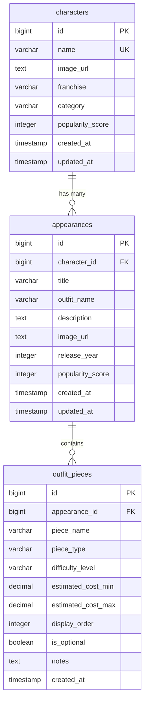
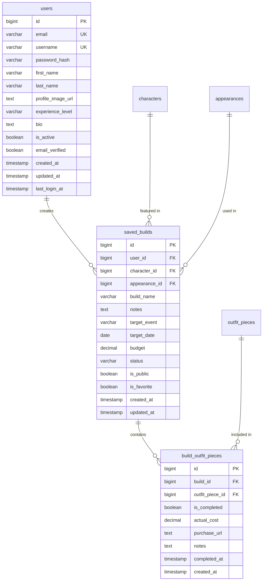
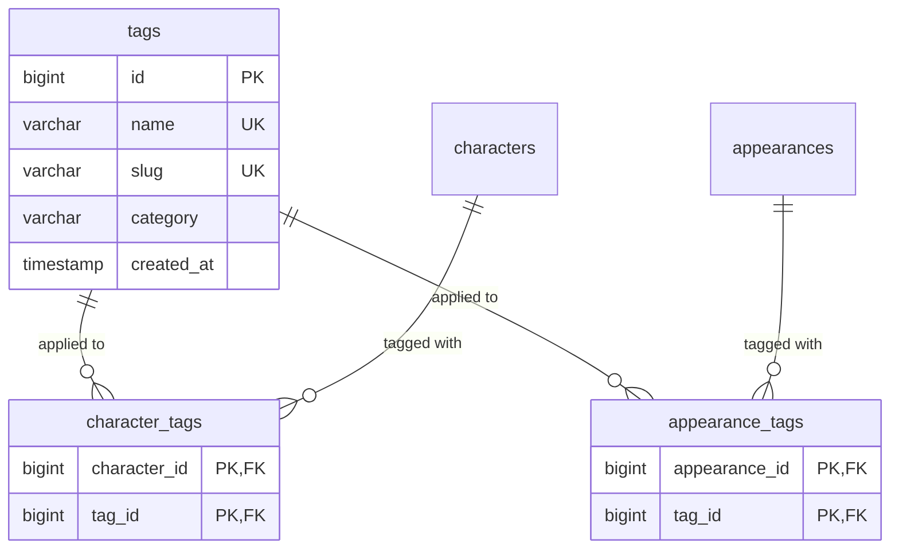
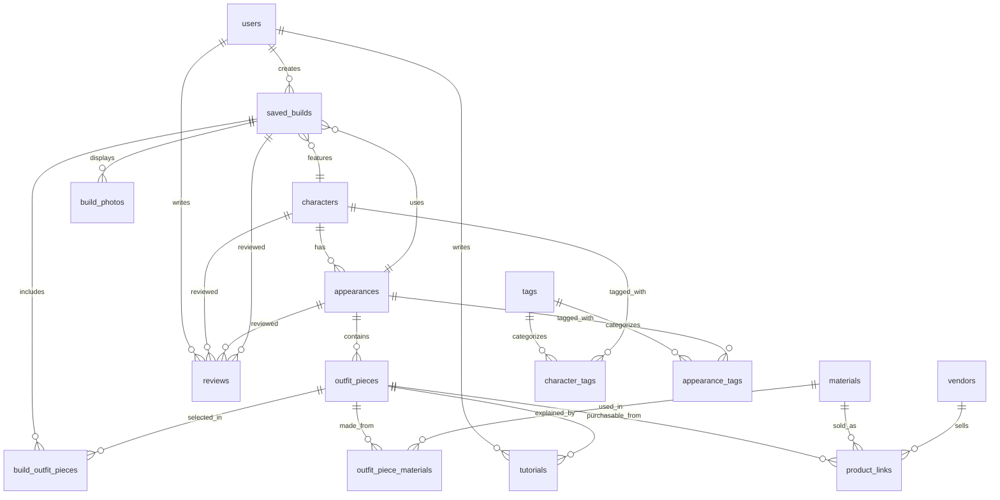

# Entity Relationship Diagram (ERD)

## Phase 1: Core Tables (MVP)

This diagram shows the relationships between the core database tables.

---

## Phase 2: User & Saved Builds

---

## Phase 3: Tags & Search

---

## Complete System Architecture

---

## Relationship Types Explained

| Symbol | Meaning |
|--------|---------|
| `||--o{` | One-to-Many (one parent, many children) |
| `}o--||` | Many-to-One (many children, one parent) |
| `||--||` | One-to-One |
| `}o--o{` | Many-to-Many |

---

## Key Relationships

### 1. **Characters → Appearances → Outfit Pieces**
- **One character** can have **many appearances** (e.g., Yelena in Black Widow vs Thunderbolts)
- **One appearance** contains **many outfit pieces** (e.g., White Jumpsuit, Tactical Vest, etc.)

### 2. **Users → Saved Builds**
- **One user** can create **many saved builds** (multiple cosplay projects)
- **One build** belongs to **one user**

### 3. **Saved Builds → Outfit Pieces (via junction table)**
- **Many-to-Many** relationship
- A build can have multiple pieces selected
- A piece can be used in multiple builds
- Junction table `build_outfit_pieces` tracks the relationship

### 4. **Tags System**
- **Many-to-Many** through junction tables
- Characters can have multiple tags (e.g., "MCU", "female", "villain")
- Tags can apply to multiple characters
- Same pattern for appearances

### 5. **Materials & Products**
- **One outfit piece** can use **many materials**
- **One material** can be used in **many outfit pieces**
- **One vendor** sells **many products**

---

## Cascade Delete Behavior

When you delete a parent record, what happens to children?

| Parent | Child | Action |
|--------|-------|--------|
| character | appearances | **CASCADE** - Delete all appearances |
| appearance | outfit_pieces | **CASCADE** - Delete all outfit pieces |
| user | saved_builds | **CASCADE** - Delete all user's builds |
| saved_build | build_outfit_pieces | **CASCADE** - Delete selections |
| saved_build | build_photos | **CASCADE** - Delete photos |

**Note:** Materials, vendors, and products use `SET NULL` or `RESTRICT` to prevent accidental data loss.

---

## Indexes for Performance

All foreign keys have indexes automatically:
- `character_id` in `appearances`
- `appearance_id` in `outfit_pieces`
- `user_id` in `saved_builds`
- etc.

Additional indexes on frequently queried columns:
- `characters.name` - for search
- `characters.franchise` - for filtering
- `characters.popularity_score` - for sorting
- `outfit_pieces.piece_type` - for filtering by type

---

## Database Normalization

This schema follows **Third Normal Form (3NF)**:

✅ **1NF**: All columns contain atomic values (no arrays in columns)  
✅ **2NF**: All non-key columns depend on the entire primary key  
✅ **3NF**: No transitive dependencies (no column depends on another non-key column)

**Example of good normalization:**
- Instead of storing outfit piece names directly in `saved_builds`, we use a junction table `build_outfit_pieces` that references the `outfit_pieces` table
- This prevents data duplication and ensures consistency

---

## How to View This Diagram

### Option 1: GitHub
Push this file to GitHub - it will automatically render the Mermaid diagrams.

### Option 2: VS Code
Install the "Markdown Preview Mermaid Support" extension.

### Option 3: Online
Copy the Mermaid code and paste it into [mermaid.live](https://mermaid.live/)

---

## Next Steps

1. Review the Phase 1 tables (characters, appearances, outfit_pieces)
2. Understand the relationships and foreign keys
3. Run the schema SQL to create tables
4. Query the data using joins to test relationships
5. Plan for Phase 2 (users and saved builds) when ready
